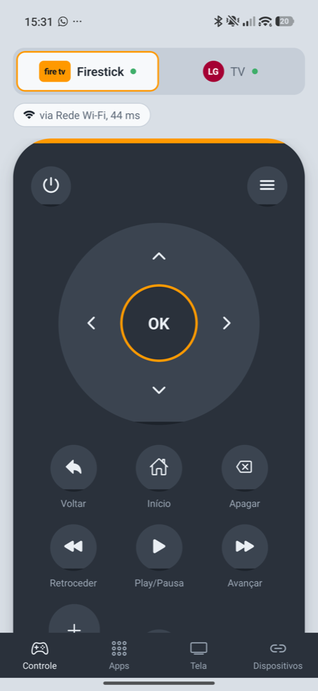
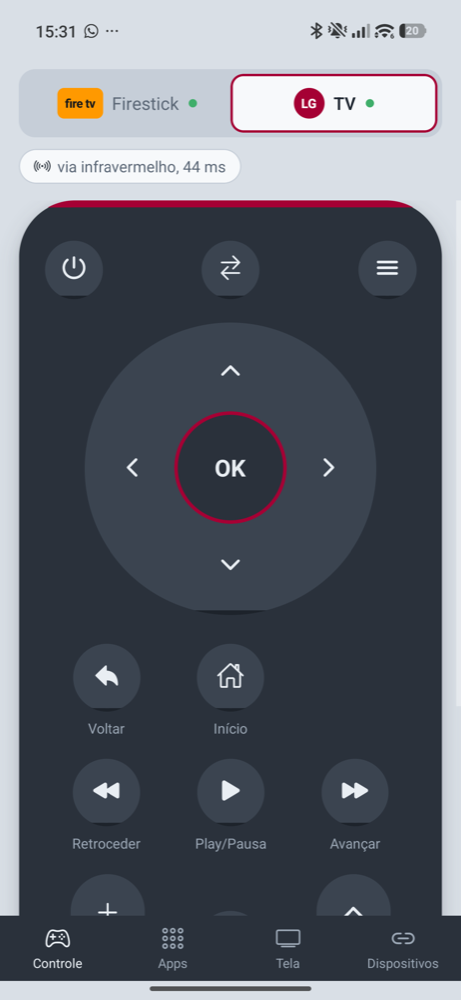
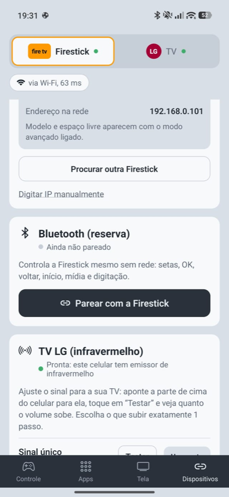
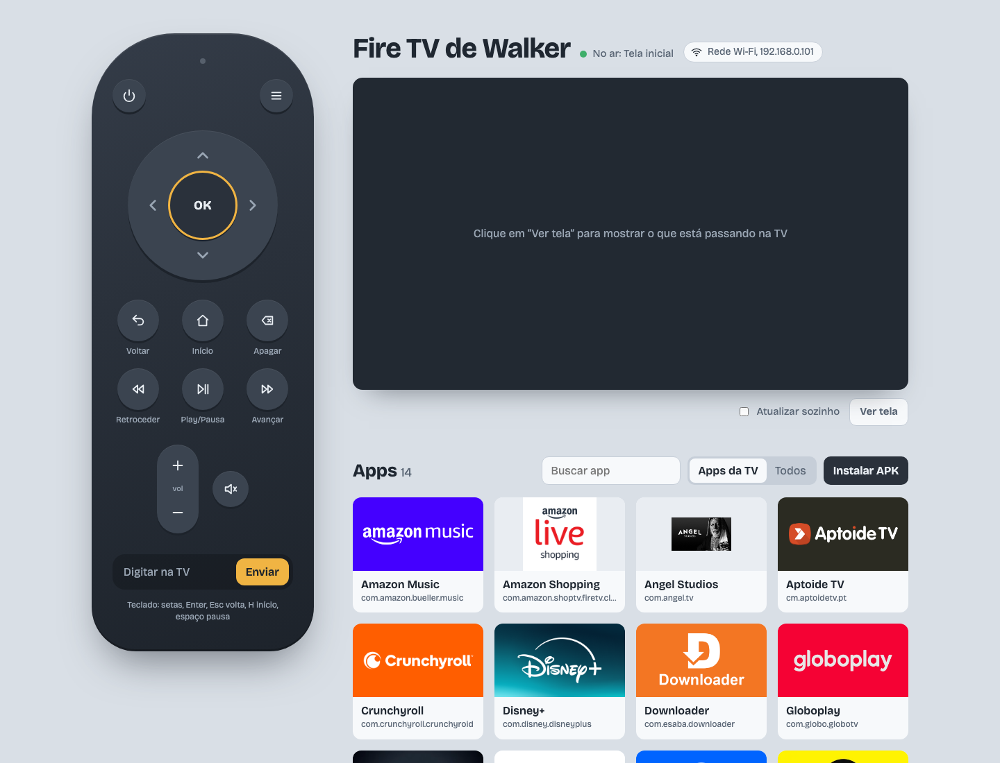

<p align="center"></p>

<h1 align="center">Controle da TV</h1>

<p align="center">Um controle remoto no celular para a Fire TV Stick e a TV LG dos meus pais.</p>

<p align="center">
  
  
  
</p>

## Objetivo

O controle físico da Fire TV some, fica sem pilha ou cai atrás do sofá, e o da TV LG é outro controle. A ideia é ter **um app só no celular** que:

- controla a **Firestick** (setas, OK, voltar, início, mídia, digitar texto, abrir apps);
- controla a **TV LG** pelo **infravermelho** do celular (volume, canal, liga/desliga, entrada);
- seja simples para os meus pais: escolhe **Firestick** ou **TV** no topo e usa;
- não dependa de nuvem, conta ou servidor: tudo fala direto com a TV pela rede de casa.

Também há um **controle web** para o Mac, usado durante o desenvolvimento e para instalar APKs na TV.

## Como funciona

O app escolhe sozinho o caminho para cada tecla:

| Caminho | Para quê | Precisa de |
| --- | --- | --- |
| **API de controle da Fire TV** (padrão) | Teclas, texto, lista e abertura de apps | Digitar uma vez o PIN que aparece na TV |
| **ADB pela rede** (modo avançado) | Instalar e desinstalar APK, ver a tela, espaço livre, ícones dos apps | Depuração ADB ligada na Firestick |
| **Bluetooth** (reserva) | Teclas e digitação quando a rede cai | Parear o celular como teclado |
| **Infravermelho** | TV LG (protocolo NEC). O volume sempre vai por aqui quando o celular tem emissor | Celular com IR (Xiaomi, Redmi, POCO…) |

Alguns detalhes:

- **Pareamento por PIN.** É a mesma API que o app oficial da Amazon usa (HTTPS na porta 8080). O certificado da TV é fixado no primeiro pareamento (*trust-on-first-use*): depois disso, outro aparelho na rede não consegue se passar por ela. O app só aceita conversar com endereços da rede local.
- **ADB sem `adb`.** O protocolo ADB (autenticação RSA, streams, `sync` para enviar APK) foi implementado em TypeScript sobre TCP. As teclas são escritas direto no dispositivo de entrada da TV (~60 ms, contra ~1,2 s do `input keyevent`).
- **Instalar APK do celular.** O app lê o APK antes de enviar (nome, ícone e processador) e avisa logo se ele não roda na Fire TV, que é 32 bits (`armeabi-v7a`).
- **Infravermelho.** Cada TV reage de um jeito ao formato do sinal. Por isso há uma tela de ajuste com três formatos para testar, e um contador ao vivo de sinais enviados, na fila e ignorados.
- **Descoberta automática.** A Firestick é encontrada na rede por mDNS (`_amzn-wplay._tcp`), com o nome que aparece nas configurações dela.

## Controle web (Mac)

<p align="center"></p>

Um servidor Node sem dependências que usa o `adb` do computador: controle, estante de apps com os banners, pré-visualização da tela da TV, instalar APK arrastando o arquivo e desinstalar.

```bash
adb connect <ip-da-firestick>:5555
npm start            # http://127.0.0.1:3000
npm run start:rede   # aberto para outros aparelhos da rede
```

> A Fire TV aceita **uma conexão ADB por vez**. Se o celular estiver no modo avançado, o Mac não conecta (e vice-versa).

## App Android

Feito com Expo (React Native + TypeScript), com um módulo nativo em Kotlin (`mobile/modules/tv-native`) para infravermelho, Bluetooth HID, mDNS, HTTPS com certificado fixado e assinatura RSA.

```bash
cd mobile
npm install
npx expo prebuild --platform android
cd android && ./gradlew assembleRelease
```

O APK sai em `mobile/android/app/build/outputs/apk/release/`. Para assinar com uma chave própria, coloque `release.properties` e o `.jks` em `mobile/credentials/` (fora do git). Sem eles, a release usa a chave de debug.

Antes de enviar mudanças:

```bash
npx tsc --noEmit
npx eslint .
```

Os scripts em `mobile/scripts/` testam o cliente ADB, o leitor de APK e a API de controle contra uma TV de verdade, rodando no Node.

## Ativar na Firestick

1. **Controle pela rede (padrão):** abra o app, escolha a Firestick encontrada e digite o PIN que aparece na TV.
2. **Modo avançado (opcional):** na TV, vá em *Configurações → Minha Fire TV → Opções do desenvolvedor → Depuração ADB*. No app, ligue o modo avançado em *Dispositivos* e aceite o pedido na TV marcando "Sempre permitir".

## Testado com

- Fire TV Stick 4K (AFTMM), Fire OS 6.7, Android 7.1
- TV LG (infravermelho NEC, endereço `0x04`)
- POCO F7, Android 16

## Licença

[MIT](LICENSE)
